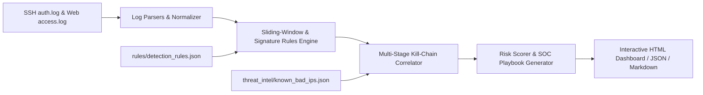

# SentinelPulse — Multi-Source SOC Detection, Correlation & Incident Triage Engine

**SentinelPulse** is a lightweight, zero-dependency Python SIEM & incident triage engine designed for Blue Team / SOC workflows. It ingests multi-source logs (`auth.log` + Nginx/Apache `access.log`), evaluates configurable detection rules mapped to **MITRE ATT&CK**, correlates multi-stage attacker kill chains across log sources, enriches source IPs with threat intelligence, generates risk-scored incidents with containment playbooks, and exports an interactive dark-mode HTML SOC dashboard.

---

## Architecture



---

## Key Features

- **Multi-Source Log Ingestion:** Parses Linux `sshd` authentication logs (`auth.log`) and Nginx/Apache Combined Access Logs (`access.log`) into unified `LogEvent` objects.
- **Cross-Log & Kill-Chain Correlation:**
  - Detects **Post-Brute-Force Compromise (`SP-CORR-001`)** when an IP fails multiple SSH logins and subsequently authenticates successfully.
  - Correlates an attacker's actions across both SSH and Web logs into a single prioritized `CorrelatedIncident` with mapped kill-chain phases (`Reconnaissance` → `Credential Access` → `Account Compromise`).
- **MITRE ATT&CK Rule Mapping:** Configurable JSON ruleset mapped to MITRE ATT&CK tactics & techniques (`T1110.001`, `T1078`, `T1087`, `T1190`, `T1059.007`, `T1005`, `T1595`).
- **Threat Intelligence & RFC1918 Awareness:** Enriches external IPs with local reputation feeds and distinguishes internal (`RFC1918`) hosts so containment playbooks do not blindly block internal infrastructure.
- **Actionable SOC Playbooks:** Generates incident-specific response steps and copy-ready containment commands (`ufw`, `iptables`, `fail2ban`, session termination).
- **Interactive HTML Dashboard + JSON + Markdown Reports:** Self-contained dark-mode SOC triage dashboard with severity breakdown, live IP/MITRE search & filter, expandable evidence logs, and JSON/Markdown exports.

---

## Detection Rules Coverage

| Rule ID | Detection Name | Source | Severity | MITRE ATT&CK |
| :--- | :--- | :--- | :--- | :--- |
| `SP-CORR-001` | SSH Success After Brute-Force | Correlation | CRITICAL | `T1078` Valid Accounts |
| `SP-SSH-001` | SSH Brute-Force Attempt | SSH | HIGH | `T1110.001` Password Guessing |
| `SP-SSH-002` | Invalid Username Enumeration | SSH | MEDIUM | `T1087` Account Discovery |
| `SP-SSH-003` | Direct Root Login Attempt | SSH | MEDIUM | `T1078.003` Local Accounts |
| `SP-WEB-001` | SQL Injection (SQLi) Probe | Web | HIGH | `T1190` Exploit Public-Facing App |
| `SP-WEB-002` | Cross-Site Scripting (XSS) Probe | Web | MEDIUM | `T1059.007` JavaScript Execution |
| `SP-WEB-003` | Path Traversal / LFI Attempt | Web | HIGH | `T1005` Data from Local System |
| `SP-WEB-004` | Sensitive File Scan (`.env`, `.git`) | Web | MEDIUM | `T1595.003` Wordlist Scanning |
| `SP-WEB-005` | High-Rate 404 Directory Enumeration | Web | MEDIUM | `T1595.002` Vulnerability Scanning |
| `SP-WEB-006` | Offensive Scanner User-Agent | Web | LOW | `T1595` Active Scanning |

---

## Quick Start

Requires **Python 3.10+** (pure standard library — zero external `pip` dependencies needed).

### 1. Run the Built-In Attack Simulation (`--demo`)
```bash
python main.py --demo
```
This generates realistic attack + normal traffic logs in `sample_logs/`, runs full detection and correlation, and outputs:
- `reports/soc_report.html` — Open in any browser for the interactive SOC dashboard
- `reports/alerts.json` — Machine-readable incident feed
- `reports/incident_summary.md` — Analyst handoff brief

### 2. Analyze Custom Logs
```bash
python main.py --auth-log /var/log/auth.log --web-log /var/log/nginx/access.log --output-dir ./reports
```

### 3. Run Automated Tests
```bash
python -m unittest discover -s tests -v
```

---

## Project Structure

```text
sentinelpulse/
├── main.py                      # CLI entrypoint
├── rules/detection_rules.json   # Configurable MITRE-mapped rules
├── threat_intel/known_bad_ips.json
├── sentinelpulse/
│   ├── models.py                # Normalized LogEvent, Alert, CorrelatedIncident
│   ├── parsers.py               # SSH & Nginx/Apache log parsers
│   ├── threat_intel.py          # IP enrichment & RFC1918 classification
│   ├── detector.py              # Sliding-window rules & kill-chain correlator
│   ├── playbooks.py             # SOC remediation & firewall containment commands
│   ├── reporter.py              # HTML dashboard, JSON & Markdown exporters
│   └── log_generator.py         # Synthetic multi-stage attack log generator
└── tests/test_sentinelpulse.py  # Unit & end-to-end tests
```
